# Discode

Discode — Discord və sosial şəbəkə funksiyalarını birləşdirən real vaxt rejimində işləyən kommunikasiya platformasıdır. İki layihədən ibarətdir:

| Layihə | Repo | Rolu |
|---|---|---|
| **Discode API** (bu repo) | `Discode-API-FinalProject` | ASP.NET Core 8 Web API + SignalR. Bütün biznes məntiqi, baza və real vaxt hadisələri burada. |
| **Discode MVC Client** | [`Discode-MVC-Client`](https://github.com/abdullafm/Discode-MVC-Client) | ASP.NET Core 8 MVC. İstifadəçi interfeysi (Razor + JavaScript). API-yə HTTP ilə qoşulur. |

> Hər iki layihə lazımdır. Əvvəlcə API, sonra MVC işə salınır.

---

## 1. Funksiyalar

**Hesab və profil**
- Qeydiyyat, e-poçt təsdiq kodu (4 rəqəm), giriş, parol və istifadəçi adı dəyişmə, parolu unutdum
- Profil şəkli, banner, bio, status, "Today I learned..." mətni, hesabı Public/Private etmək
- Şəkil seçilməyibsə istifadəçi adının ilk hərfindən avtomatik hərf avatarı
- Dil seçimi: İngilis, Türk, Azərbaycan, Rus (tərcümələr bazada saxlanır)

**Dostluq və şəxsi mesajlar**
- Dostluq sorğusu (göndər, qəbul et, rədd et), bloklama, "ignore"
- Birbaşa mesajlar: mətn, fayl, emoji reaksiyalar, cavab (reply), redaktə, silmə, sancaqlama (pin), yönləndirmə (forward), sorğular (poll), mesaj axtarışı
- Yazır... göstəricisi, oxunmamış sayğacı, onlayn/oflayn statusu
- Səsli və görüntülü zənglər (WebRTC), ekran paylaşımı

**Qruplar**
- Qrup söhbətləri (10 nəfərə qədər), qrup zəngləri, qrup sahibi və üzv idarəsi, qrup ikonu

**Serverlər (Discord tipli)**
- Server yaratmaq, ikon və banner, dəvət linki, kateqoriya, mətn və səs kanalları
- Rollar və icazələr, kanal üzrə icazə qaydaları (overwrite), üzv profili
- Moderasiya: ban, kick, timeout, mute, prune, audit log
- Yavaş rejim (slowmode), server sahibliyini ötürmək, server şablonları (şablon linkindən yeni server)
- Səs kanalları (WebRTC), server bust (boost) sistemi
- Serverdə **OwO oyunu** (owner söndürüb-yandıra bilir): hunt, zoo, daily, cf, slots, battle və s.

**Sosial şəbəkə**
- Postlar (şəkil və video), şərhlər və cavablar, bəyənmə, repost, paylaşma (dostlara və qruplara)
- Hekayələr (story): baxışlar, bəyənmə, cavab
- Canlı yayım (Live): izləyici çatı, qonaq, moderator, çatda susdurma, dəvət
- Kəşf (Discover): açıq serverlər və kateqoriyalar

**Nitro (ödənişli abunəlik)**
- Stripe ilə aylıq abunəlik və hədiyyə linki
- Limitsiz mesaj, 2 GB fayl, animasiyalı avatar və banner, 2 server boost, Nitro nişanı

**Admin paneli**
- İstifadəçilər, serverlər, məzmun, şikayətlər, canlı yayımlar, Nitro, brendinq (logo və tema), fəaliyyət jurnalı

---

## 2. Texnologiyalar

| Qat | Texnologiya | Nə üçün |
|---|---|---|
| Platforma | **.NET 8**, ASP.NET Core | API və MVC |
| Baza | **SQL Server**, **Entity Framework Core 8** (Code First, migrasiyalar) | Məlumatın saxlanması |
| Giriş | **ASP.NET Core Identity**, **JWT Bearer** | Qeydiyyat, rollar, token |
| Real vaxt | **SignalR** (`PresenceHub`) | Mesaj, status, yazır..., zənglər, canlı yayım |
| Zənglər | **WebRTC** (siqnal SignalR ilə) | Səs, video, ekran paylaşımı |
| Ödəniş | **Stripe.net** | Nitro abunəliyi |
| E-poçt | **SMTP** (Gmail) | Təsdiq kodu, parol bərpası |
| Validasiya | **FluentValidation** | Giriş DTO yoxlamaları |
| Mapping | **AutoMapper** | Entity ↔ DTO |
| Loqlar | **Serilog** (konsol + gündəlik fayllar) | api, errors, audit loqları |
| Sənədləşmə | **Swagger / Swashbuckle** | API test və sənəd |
| Testlər | **xUnit**, `WebApplicationFactory`, EF InMemory | 175 test |
| İstifadəçi interfeysi | **ASP.NET Core MVC**, Razor, vanilla JavaScript, CSS | Client |

---

## 3. Arxitektura

```
 Brauzer ──► MVC Client (Razor, JS) ──HTTP + Bearer token──► API (Controllers)
    ▲                                                            │
    │                                                            ▼
    └──────────── SignalR (WebSocket, /hubs/presence) ◄──── Service qatı ──► Repository ──► SQL Server
```

API 4 qatlı layihədir (təmiz arxitektura):

| Layihə | Məsuliyyət |
|---|---|
| `Domain` | Entity-lər, enum-lar, konfiqurasiyalar, sabitlər. Heç nədən asılı deyil. |
| `Repository` | `AppDbContext`, repozitoriyalar, migrasiyalar, seed (rollar, emoji, tərcümələr, sistem istifadəçisi). |
| `Service` | Biznes məntiqi (60-dan çox servis), DTO-lar, validatorlar, AutoMapper profili, icazə qaydaları. |
| `Discode-API-FinalProject` | Controller-lər, SignalR hub-ları, middleware və filtrlər, `Program.cs`. |
| `Discode.Tests` | Servis, HTTP API və hub testləri. |

**MVC Client** API-nin üstündə nazik qatdır: controller-lər `HttpClient` ilə API-ni çağırır, `BearerTokenHandler` hər sorğuya istifadəçinin JWT tokenini əlavə edir. Token şifrəli cookie-də saxlanır. Səhifələr arası keçid "pjax" tərzindədir (`nav.js`), brauzer səhifəni tam yeniləmir.

### Necə işləyir

1. **Giriş.** İstifadəçi MVC-də daxil olur → MVC API-yə `login` göndərir → API JWT qaytarır → MVC onu auth cookie-də saxlayır. Sonrakı hər sorğuda `BearerTokenHandler` tokeni `Authorization` başlığına qoyur.
2. **Real vaxt.** Səhifə yüklənəndə brauzer JavaScript ilə API-dəki `/hubs/presence` hub-ına qoşulur. Mesaj göndərildikdə API mesajı bazaya yazır və alıcıya `DirectMessage`, `GroupMessage` və s. hadisəsini SignalR ilə göndərir.
3. **Zənglər.** SignalR yalnız siqnal (offer, answer, ICE) daşıyır. Səs və video birbaşa iştirakçılar arasında WebRTC ilə gedir.
4. **İcazələr.** Server əməliyyatları `ServerPermissionService` ilə yoxlanır: server sahibi, rol icazələri və kanal overwrite-ları nəzərə alınır.
5. **Nitro.** MVC Stripe Checkout-a yönləndirir, Stripe webhook-u API-yə gəlir, API abunəliyi bazaya yazır. `NitroExpiryWorker` vaxtı bitən abunəlikləri bağlayır.
6. **Fon işləri** (`HostedService`): `VoiceGhostSweeper` (səs kanalında ilişib qalanları təmizləyir), `NitroExpiryWorker`, `StatusClearWorker` (müvəqqəti statusları silir).
7. **Təhlükəsizlik.** Giriş və qeydiyyatda rate limit (`auth` siyasəti, istehsalda dəqiqədə 10), parollar Identity ilə hash olunur, loqlarda gizli məlumat maskalanır (`LogRedactor`), fayl yükləmə ölçü və tip yoxlamasından keçir.
8. **Tərcümə.** İngilis mətni açar kimi işləyir, Türk, Azərbaycan və Rus dəyərləri `Translations` cədvəlindən gəlir (`translations.json` başlanğıcda bazaya yazılır). Brauzer `i18n.js` ilə səhifədəki mətni dəyişir.

---

## 4. Məlumat modeli (əsas hissə)

```mermaid
erDiagram
    AppUser ||--o{ Message : "göndərir"
    Conversation ||--o{ Message : "ehtiva edir"
    AppUser ||--o{ FriendRequest : "dostluq"
    AppUser ||--o{ Post : "paylaşır"
    Post ||--o{ Comment : "şərhlər"
    Post ||--o{ PostLike : "bəyənmə"
    AppUser ||--o{ Story : "hekayə"
    AppUser ||--o{ GroupMember : "üzvlük"
    Group ||--o{ GroupMember : "üzvlər"
    Group ||--o{ GroupMessage : "mesajlar"
    AppUser ||--o{ ServerMember : "üzvlük"
    Server ||--o{ ServerMember : "üzvlər"
    Server ||--o{ ServerCategory : "kateqoriya"
    Server ||--o{ ServerChannel : "kanallar"
    ServerCategory ||--o{ ServerChannel : "ehtiva edir"
    Server ||--o{ ServerRole : "rollar"
    ServerMember ||--o{ ServerMemberRole : "rol verilir"
    ServerRole ||--o{ ServerMemberRole : "verilir"
    ServerChannel ||--o{ ServerMessage : "mesajlar"
    ServerChannel ||--o{ ServerOverwrite : "icazə qaydaları"
    Server ||--o{ ServerBan : "ban"
    Server ||--o{ ServerAuditLog : "jurnal"
    Server ||--o{ ServerBoost : "boost"
    Server ||--o| ServerTemplate : "şablon"
    AppUser ||--o| NitroSubscription : "abunəlik"
    AppUser ||--o{ NitroGift : "hədiyyə"
    AppUser ||--o{ LiveStream : "yayım"
    AppUser ||--o{ Notification : "bildiriş"
    AppUser ||--o{ Report : "şikayət"
    AppUser ||--o| OwoProfile : "oyun profili"
    OwoProfile ||--o{ OwoAnimal : "heyvanlar"
```



Bütün cədvəllər (60-dan çox) `Domain/Entities` qovluğundadır. Konfiqurasiyalar `Domain/Configurations`-dadır. Migrasiyalar `Repository/Migrations`-dadır və API başlayanda avtomatik tətbiq olunur.

---

## 5. Qovluq strukturu

```
Discode-API-FinalProject/
├── Domain/                      Entity-lər, enum-lar, konfiqurasiyalar
├── Repository/                  DbContext, repozitoriyalar, migrasiyalar, Data/Seed
├── Service/                     Servislər, DTO-lar, validatorlar, mapping
│   └── Helpers/                 DTOs, Validators, Mappings, Settings, qaydalar
├── Discode-API-FinalProject/    Controllers (Client + Admin), Hubs, Middlewares, Program.cs
├── Discode.Tests/               xUnit testləri
└── bacpac.bacpac                Verilənlər bazasının ehtiyat nüsxəsi (SSMS ilə import olunur)
```

---

## 6. Necə işə salmalı

### Tələblər
- **.NET 8 SDK**
- **SQL Server** (Visual Studio ilə gələn LocalDB və ya SQL Server Express yetərlidir)
- Visual Studio 2022 və ya VS Code

### Addımlar

1. **Hər iki repo-nu klonla** (eyni qovluğun içində):
   ```
   git clone https://github.com/abdullafm/Discode-API-FinalProject.git
   git clone https://github.com/abdullafm/Discode-MVC-Client.git
   ```
   Əgər `master` boşdursa və ya köhnədirsə, `developer` branch-ını götür: `git clone -b developer ...`.

2. **Baza ünvanını yoxla.** `Discode-API-FinalProject/appsettings.Development.json` içində `ConnectionStrings:DefaultConnection` sənin SQL Server-inə işarə etməlidir. Məsələn, LocalDB üçün:
   ```json
   "DefaultConnection": "Server=(localdb)\\MSSQLLocalDB;Database=DiscodeDB;Trusted_Connection=true;TrustServerCertificate=true;"
   ```
   Baza yoxdursa, API ilk başlayanda özü yaradır və migrasiyaları tətbiq edir.

3. **API-ni işə sal** (`Discode-API-FinalProject` layihəsi, **https** profili → `https://localhost:7222`). Swagger: `https://localhost:7222/swagger`.
   ```
   cd Discode-API-FinalProject/Discode-API-FinalProject
   dotnet run --launch-profile https
   ```

4. **MVC-ni işə sal** (`https://localhost:7208`):
   ```
   cd Discode-MVC-Client/Discode-MVC-Client
   dotnet run --launch-profile https
   ```
   MVC `appsettings.json`-dakı `ApiSettings:BaseUrl` (`https://localhost:7222/`) ünvanından API-yə qoşulur.

5. Brauzerdə `https://localhost:7208` aç, qeydiyyatdan keç. Təsdiq kodu e-poçtla gəlir.

> Visual Studio-da hər iki layihəni "Multiple startup projects" ilə eyni anda başlatmaq olar. F5 `ASPNETCORE_ENVIRONMENT=Development` qoyur, Stripe test açarı və rate limit ayarları bu rejimdə işləyir.

### Konfiqurasiya

| Açar | Fayl | Məna |
|---|---|---|
| `ConnectionStrings:DefaultConnection` | API | SQL Server bağlantısı |
| `Jwt:Key`, `Issuer`, `Audience`, `ExpiryMinutes` | API | JWT ayarları |
| `App:ClientUrl` | API | MVC ünvanı (CORS və e-poçt linkləri üçün) |
| `Email:*` | API | SMTP (təsdiq kodu, parol bərpası) |
| `Stripe:SecretKey` | API (`appsettings.Development.json`) | Stripe **test** açarı (Nitro ödənişi) |
| `Seed:SuperAdminEmail` | API | Bu e-poçta uyğun istifadəçi SuperAdmin rolu alır |
| `Logs:Folder` | API | Log faylları qovluğu |
| `ApiSettings:BaseUrl` | MVC | API ünvanı |

Gizli məlumatları (SMTP parolu, Stripe açarı, JWT açarı) real layihədə `dotnet user-secrets` və ya mühit dəyişənləri ilə saxla.

### Admin hesabı
`Seed:SuperAdminEmail` açarına öz e-poçtunu yaz, həmin e-poçtla qeydiyyatdan keç. Başlanğıcda hesab SuperAdmin olur və `https://localhost:7208/Admin` açılır.

### Verilənlər və şəkillər
- Yüklənən şəkillər MVC-də `wwwroot/uploads` qovluğundadır və repoya daxildir. Təmiz klonda da görünür.
- `bacpac.bacpac` mövcud test məlumatlarını ehtiva edir. SSMS-də **Import Data-tier Application** ilə yüklə, sonra connection string-i həmin bazaya yönəlt.

---

## 7. Testlər

```
dotnet test
```

175 test: servis qaydaları, HTTP API (in-memory test host, Stripe və e-poçt saxta), SignalR hub-ları. Testlər ayrıca bazaya ehtiyac duymur.

Əhatə: qeydiyyat və e-poçt kodu, dostluq, bloklama, DM, qruplar, serverlər, kanallar, rollar, moderasiya, səs, hekayələr, postlar və şərhlər, canlı yayım, Nitro, bildirişlər, şikayətlər, yavaş rejim, sahiblik ötürmə, şablonlar, OwO oyunu, qrup paylaşımı.

---

## 8. Məlum məhdudiyyətlər

- Əsas test mühiti: Windows + SQL Server. Başqa SQL provayderi üçün migrasiyalar yenidən yaradılmalıdır.
- Zənglər üçün brauzerə mikrofon və kamera icazəsi verilməlidir. İnternet üzərindən zənglər üçün TURN serveri qurulmayıb (yerli şəbəkədə və birbaşa bağlantıda işləyir).
- Stripe yalnız **test rejimindədir**.
- OwO oyunu, qısa komandalar və "cowoncy" iqtisadiyyatı ilə Discord-dakı OwO botunun sadələşdirilmiş versiyasıdır.
